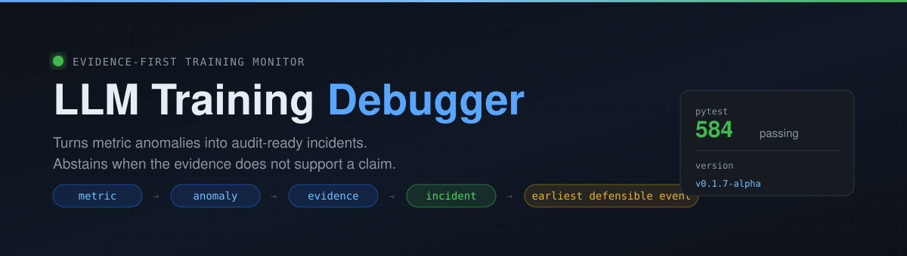
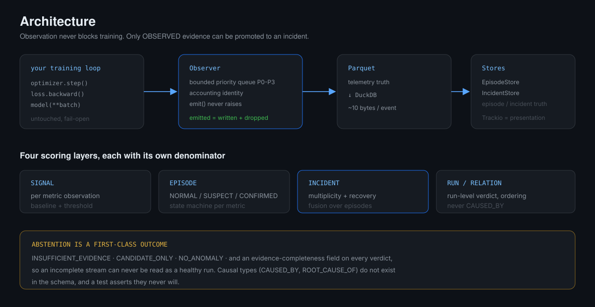
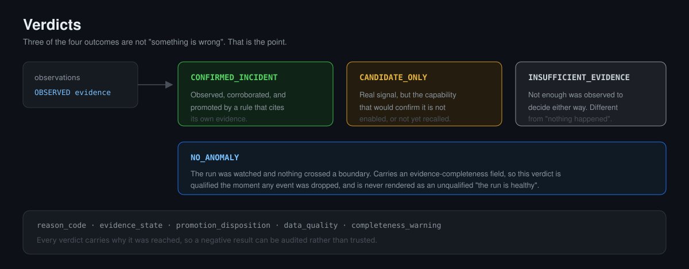
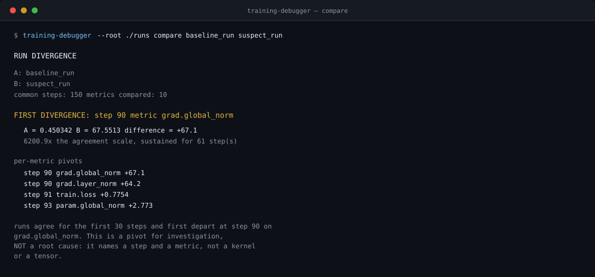

<div align="center">



<br>

[English](../../README.md) · [简体中文](README.zh-CN.md) · **한국어** · [日本語](README.ja.md) · [Français](README.fr.md)

<br>

[](../../tests)
[](../../pyproject.toml)
[](../../LICENSE)
[](#프로젝트-상태)
[](https://github.com/topics/deepseek-harness)

</div>

---

## 이것은 무엇인가

**증거 우선(evidence-first) PyTorch 학습 모니터링 라이브러리**입니다. 학습 루프를 관찰하고
지표 이상을 인시던트(incident)로 바꾸며, 가장 중요한 점으로서 **증거가 결론을 뒷받침하지 못할 때는
결론을 내리기를 거부**합니다.

<div align="center">

</div>

대부분의 학습 도구는 "무슨 일이 일어났는가"에 답합니다. 이 라이브러리는 더 좁고 더 어려운 질문을 던집니다:

> **나는 정말로 알고 있는가? 아니라면, 내가 가진 것은 정확히 무엇인가?**

## 이것이 아닌 것

경계를 먼저 밝힙니다. 정직한 경계가 기능 목록보다 유용하기 때문입니다:

- **실험 추적 도구의 대체재가 아닙니다.** 추적 도구로 데이터를 내보내지만, 그 자체가 대시보드는 아닙니다.
- **근본 원인 분석이 아닙니다.** *어느 스텝, 어느 지표*를 보고합니다. 어떤 커널, 어떤 텐서,
  어느 코드 한 줄인지는 알려줄 수 없습니다.
- **제어기가 아닙니다.** 관찰만 합니다. 그래디언트를 클리핑하거나, 옵티마이저 상태를 초기화하거나,
  학습을 중단하지 않습니다.
- **대규모에서 검증되지 않았습니다.** 이 저장소의 모든 수치는 4–6층 모델에서 측정되었습니다.
- **검증되지 않았습니다.** 블라인드 홀드아웃이 없습니다. `validated_capabilities`는 설계상 비어 있습니다.

## 왜 필요한가

하나의 학습은 loss 곡선을 만들어냅니다. 곡선이 잘못될 때, 곡선은 어디가 문제인지 말해주지 않으며
다시 실행해도 좀처럼 재현되지 않습니다.

이 라이브러리의 입장은 이것입니다: **제품은 그래프가 아니라 인시던트다** — 무엇이 관찰되었는지에 대한
**경계가 있고 감사 가능하며 타임스탬프가 찍힌** 주장으로서, 그 근거를 함께 지니고
**무엇을 결론지을 수 없었는지를 명시**합니다.

이 입장은 설계 전반에 걸쳐 나타납니다:

| 원칙 | 코드에서의 구현 |
|---|---|
| 관찰은 학습을 절대 방해해서는 안 된다 | `emit()`은 예외를 던지지 않음; P0–P3 유계 큐는 차단 대신 드롭 |
| 메커니즘을 주장하기 전에 증거가 관찰되어야 한다 | `OBSERVED` / `INFERRED` / `HYPOTHESIS` / `UNKNOWN`; `OBSERVED`만 승격 가능 |
| 관찰의 부재는 부정적 관찰이 아니다 | 모든 판정이 `data_quality`와 `completeness_warning`을 지님 |
| 조작된 관계보다 기권을 우선한다 | `INSUFFICIENT_EVIDENCE`는 오류가 아닌 일급 판정 |
| 어떤 인과적 주장은 불가능해야 한다 | `CAUSED_BY`와 `ROOT_CAUSE_OF`는 **스키마에 존재하지 않으며**, 영원히 그러하도록 테스트가 강제 |

## 빠른 시작

```bash
git clone https://github.com/YanKaFei/LLM-Training-Debugger.git
cd LLM-Training-Debugger
python -m venv .venv && . .venv/bin/activate
pip install -e ".[dev]"
```

완전하게 실행 가능한 예제:

```bash
python examples/quickstart.py
```

기존 학습 루프에 바로 넣을 수도 있습니다:

```python
from training_debugger.adapters.pytorch import PyTorchTrainingAdapter

adapter = PyTorchTrainingAdapter(observer, model, optimizer, model_id="my-model")
adapter.run_start(steps=total_steps)

for step in range(1, total_steps + 1):
    with adapter.step(step) as tracker:
        loss = model(**batch)["loss"]
        tracker.record_loss(loss)
        loss.backward()
        tracker.record_gradients()
        with tracker.phase("optimizer"):
            optimizer.step()
        optimizer.zero_grad(set_to_none=True)
        tracker.record_parameters()

adapter.run_end()
```

## 무엇을 얻는가

<div align="center">

</div>

각 인시던트는 `reason_code`, `evidence_state`, `promotion_disposition`을 지니며,
스트림이 불완전했을 때는 `data_quality` 경고를 함께 지닙니다.
**이벤트가 유실된 런은 결코 건강한 런으로 표시되지 않습니다.**

## 명령어

<div align="center">

</div>

```bash
training-debugger --root <store> runs                  # 런 목록
training-debugger --root <store> verdicts  <run>       # 기권을 포함한 모든 판정
training-debugger --root <store> incidents <run>       # 근거가 포함된 인시던트
training-debugger --root <store> incident  <run> <id>  # 인시던트 하나의 전체 내용
training-debugger --root <store> metrics   <run> [m]   # 지표 행 조회
training-debugger --root <store> diagnose  <run>       # 결정적 진단
training-debugger --root <store> compare   <a> <b>     # 두 런이 갈라지는 첫 스텝
training-debugger --root <store> scan      <r1> ...    # 배치: 어느 런이 이상치인가
```

### `compare` — 분기 지점 찾기

두 런의 지표 시계열을 정렬하고, **초기에 두 런이 일치하는 구간을 귀무 모델로 사용**하여,
그 범위를 벗어나 유지되는 첫 스텝을 보고합니다. 공통 잡음이 차분에서 상쇄되기 때문에,
단일 런 임계값으로는 불가능한 위치 특정이 가능합니다.

주입 스텝이 알려진 페어 코퍼스에서 측정: **9/9 결함 쌍이 정확한 주입 스텝에 특정되었고,
3/3 정상 쌍은 올바르게 기권했습니다.**

월클럭 및 메모리 지표는 기본적으로 제외됩니다 — *타이밍 차이는 알고리즘적 분기가 아닙니다*.

### `scan` — 배치에서 이상치 찾기

모든 쌍을 한 번씩 비교하며, 각 런의 점수는 몇 개의 동료와 갈라졌는지입니다.
**like-for-like 런이 필요합니다**: 시드와 구성을 고정하고 한 요소만 바꾸십시오.
시드가 섞인 배치에서는 런 이름을 지어내는 대신 `NO_SINGLE_OUTLIER`를 반환하고 그 이유를 설명합니다.

## 기능

모든 기능은 명시적인 증거 등급을 지닙니다. 여기서 검증됨으로 표시된 것은 없습니다.

| 기능 | 상태 | 증거 |
|---|---|---|
| 비유한값 관찰 (NaN / Inf) | `EXPERIMENTAL` | 정확함; 임계값 불필요 |
| 그래디언트 이상 탐지 | `EXPERIMENTAL` | 탐지 경계 ×20, ×40 → 6/6; ×2, ×5 → 0/6 |
| 기권을 포함한 인시던트 융합 | `EXPERIMENTAL` | 런 precision 0.947 / recall 0.500 (42-런 코퍼스) |
| 두 런 분기 위치 특정 | `EXPERIMENTAL` | 9/9 정확, 3/3 기권 (페어 코퍼스) |
| 배치 이상치 스캔 | `EXPERIMENTAL` | like-for-like 배치에서 5/5 동료 지지 |
| 모듈별 활성화 건강 상태 | `EXPERIMENTAL` | 죽은 모듈을 OBSERVED 1.0으로 지목하고 시점 특정 |
| 옵티마이저 호출 증인 | `EXPERIMENTAL` | 동결됨; 기본 비활성 |
| 관계 추론 (순서만) | `UNSUPPORTED` | 기본 비활성; 한 번의 측정된 시도가 16개의 연관을 조작함 |

## 알려진 한계

공개합니다. **실패가 기록되지 않은 모니터는 신뢰할 수 없기** 때문입니다:

- **런 수준 recall은 0.500입니다.** 개발 코퍼스의 주요 결함 중 절반을 놓칩니다.
- **건강한 런 오탐률 7.7%**, 자체 설정 게이트는 5%입니다. **이 게이트는 실패합니다.**
- **관측자 오버헤드가 자체 <3% 목표를 달성하지 못합니다** (4층 벤치마크 워크로드).
  비용은 스텝당 대략 *고정* (0.2–0.9 ms)이므로, 워크로드가 커질수록 비율이 급감합니다:
  +11.0% (4층) → +5.2% (8층) → +0.4% (12층). 스텝이 약 17 ms를 넘으면 예산 안입니다.
  **변명하지 않고 실패로 보고합니다.**
- 블라인드 홀드아웃이 없으며, 모든 수치는 개발 코퍼스에서 나왔습니다.
- 4–6층 모델에서만 검증되었습니다.

전체 목록: [KNOWN_LIMITATIONS.md](../../KNOWN_LIMITATIONS.md) · 설계 기록:
[DECISIONS.md](../DECISIONS.md) · 현재 상태: [DEVELOPMENT_STATE.md](../DEVELOPMENT_STATE.md)

## 수치 재현

```bash
pytest -q                                            # 584 통과, 1 건너뜀
python tests/experiments/full_pipeline_smoke.py      # 8/8
python examples/quickstart.py
python tests/performance/audit_observer_cost.py      # 신뢰구간을 포함한 페어 오버헤드
```

이 README의 모든 핵심 수치는 `tests/experiments/` 또는 `tests/performance/`의 스크립트가
생성하며, 원시 출력은 `outputs/` 아래에 커밋되어 있습니다.

## 프로젝트 상태

**Alpha.** 인터페이스는 안정적이지 않으며 API는 예고 없이 변경될 수 있습니다.
학습에 계측을 넣고 감사 가능한 판정을 읽는 데는 실제로 유용하지만,
아직 그 위에 프로덕션 파이프라인을 구축할 단계는 아닙니다.

## 피드백과 논의

**GitHub이 이 프로젝트를 논의하는 유일한 장소입니다.** 채팅 서버도, 메일링 리스트도,
다른 채널도 없습니다 — 따라서 여기서 제기된 것은 누구나 볼 수 있고 검색 가능하게 남습니다.

| | |
|---|---|
| **버그를 발견하셨나요?** | [이슈 열기](https://github.com/YanKaFei/LLM-Training-Debugger/issues/new) |
| **질문이 있거나 설계 결정을 논의하고 싶으신가요?** | [토론 시작](https://github.com/YanKaFei/LLM-Training-Debugger/discussions) |
| **기능을 원하시나요?** | [이슈 열기](https://github.com/YanKaFei/LLM-Training-Debugger/issues/new) |
| **여기의 주장에 동의하지 않으시나요?** | [이슈 열기](https://github.com/YanKaFei/LLM-Training-Debugger/issues/new) — 꼭 해주십시오 |

**반론을 환영하며, 특히 수치에 대한 반론을 환영합니다.** 이 README의 측정을 재현했는데
다른 결과가 나온다면, 그것은 제출할 가치가 있는 버그 리포트입니다. 여기의 어떤 주장이
이 저장소의 증거로 뒷받침되지 않는다면, **그 주장은 틀린 것이며** 정정되거나 철회되어야 합니다.

보고 시 다음을 포함해 주십시오: 실행한 명령, 모델 형태와 스텝 수, PyTorch 버전, 전체 출력.

## 기여

[CONTRIBUTING.md](../../CONTRIBUTING.md)를 참조하십시오. 요약: **주장을 약하게 만드는 변경은
강하게 만드는 변경만큼 환영받으며**, **테스트를 통과시키기 위해 테스트를 약화시키는 것은 결코 허용되지 않습니다**.

## 라이선스

[Apache-2.0](../../LICENSE).

<div align="center">
<br>
<sub><a href="https://github.com/topics/deepseek-harness">DeepSeek Harness</a>로 제작되었습니다.</sub>
</div>
